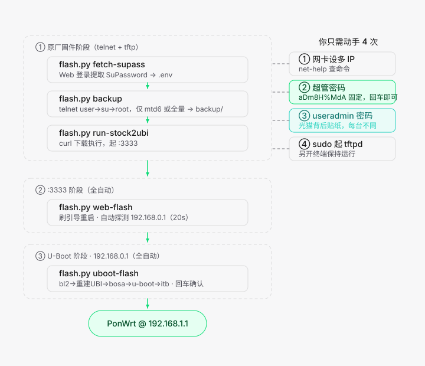

# an758x-ont-autoflash

Airoha AN758x 系列 GPON 光猫**免拆自动刷机工具**：无需拆机焊 TTL 线，一根网线即可完成从原厂固件到 PonWrt/OpenWrt 的全自动刷写。

> Automated no-disassembly flasher for Airoha AN758x-based GPON ONTs (e.g. Nokia XG-040G-MD).
> Telnet + HTTP pipeline, pure Python standard library, zero dependencies, cross-platform.

## 特性

- **免拆机**：全程 telnet + HTTP，不需要 TTL 串口、不需要拆壳
- **一键菜单**：`python3 scripts/flash.py` 进入 1→6 步引导式菜单，新手按顺序选即可
- **零依赖**：纯 Python 3 标准库实现，无需 pip install，macOS / Linux / Windows 通用
- **安全可靠**：
  - 刷机前自动备份 mtd6-bosa（光模块校准数据，**每台唯一、丢失不可再生**）
  - 已有备份自动归档防覆盖，上传校验非空才替换
  - Web/telnet 凭据仅在**登录成功后**才缓存，输错不残留
- **断点续刷**：U-Boot 阶段 5 个步骤可任意单独重复执行，失败原地重试
- **HTTP 文件传输**：设备端 curl 上传/下载（替代 TFTP），速度快、可调试；TFTP 代码保留备用

## 支持机型

| 机型 | 型号 | SoC | 状态 |
|---|---|---|---|
| MD | 诺基亚 Nokia XG-040G-MD（移动定制） | Airoha AN7581 | ✅ 已支持并实测 |
| TF | 天邑 TF 系列（移动定制） | Airoha AN758x | 🚧 规划中（凭据/目录框架已预留） |

## 快速上手

### 1. 准备

- 一台电脑（macOS / Linux / Windows），Python 3.8+
- 一根网线，连接电脑与光猫千兆口
- 光猫**通电开机**（原厂固件）
- 给电脑网卡配置多 IP（脚本会引导，也可先运行 `python3 scripts/flash.py net-help` 查看命令）：
  - `192.168.1.x`：访问原厂系统
  - `192.168.1.254`：本机 HTTP 服务地址（光猫通过它访问电脑）
  - `192.168.0.16`：访问 U-Boot 恢复页（192.168.0.1）

### 2. 运行

```bash
git clone https://github.com/traceless/an758x-ont-autoflash.git
cd an758x-ont-autoflash
python3 scripts/flash.py
```

进入主菜单，按 1→6 顺序执行：

```
============================================================
 刷机主菜单
============================================================
  1. [ ] 检查环境            ← 依赖/固件/连通性自检，选择本机 HTTP IP
  2. [ ] 开启 telnet         ← Web 登录自动开启（MD 默认 CMCCAdmin / aDm8H%MdA）
  3. [ ] 查询 SuPassword     ← 下载日志包自动提取超密
  4. [ ] 备份 mtd 分区       ← 可选仅 mtd6-bosa（推荐）或全量 mtd0~16
  5. [ ] 刷引导              ← 自动 run-stock2ubi 起 :3333 → 刷 bl2+fip → 重启
  6. [ ] U-Boot 恢复页刷机   ← 192.168.0.1 五步子菜单（bl2→UBI→bosa→u-boot→固件）
  0. 退出
```

每步可重复执行；失败排查后重选该步即可。首次使用一路回车即可（出厂默认凭据已内置为提示默认值），配置在首次登录成功后自动写入 `scripts/.env`。

### 3. 刷机流程详解

完整的流程图、凭据说明、手动操作点见 [刷机流程图.md](刷机流程图.md)，原始教程见 [xg-040g-md免拆教程.md](xg-040g-md免拆教程.md)。



## 命令行子命令（高级用法）

主菜单之外，所有功能均可单独调用：

```bash
python3 scripts/flash.py check            # 环境自检
python3 scripts/flash.py net-help         # 三平台网卡多 IP 配置命令
python3 scripts/flash.py enable-telnet    # 开启 telnet
python3 scripts/flash.py fetch-supass     # 提取 SuPassword
python3 scripts/flash.py backup [--mode bosa|full]   # 分区备份
python3 scripts/flash.py run-stock2ubi    # 拉起设备 :3333 服务
python3 scripts/flash.py web-flash        # 刷 bl2+fip 进 U-Boot
python3 scripts/flash.py uboot-flash [--step N]      # U-Boot 五步刷机
python3 scripts/flash.py httpd            # 独立 HTTP 文件服务（默认内联，无需单独跑）
python3 scripts/flash.py tftpd            # TFTP 服务（备用方案）
```

常用参数：`--model MD` / `--http-ip` / `--http-port` / `--router`，详见 `-h`。

## 目录结构

```
an758x-ont-autoflash/
├── scripts/
│   ├── flash.py            # 主入口（菜单 + 全部子命令）
│   ├── lib/                # telnet/web/HTTP/UBI 刷写等核心模块
│   ├── http_server.py      # HTTP 文件服务（GET 下载 + PUT 上传）
│   ├── tftp_server.py      # TFTP 服务（RFC1350+2347，备用）
│   └── .env.example        # 配置键说明（.env 运行时自动生成，已 gitignore）
├── md-uboot/               # MD 机型固件（preloader / fip / sysupgrade.itb）
├── tools/
│   └── an758x-stock2ubi    # 免拆包（设备端运行，起 :3333 服务）
├── backup/                 # 分区备份输出（已 gitignore，每台设备唯一）
├── 刷机流程图.md           # 流程图 + 凭据表 + 操作速查
└── xg-040g-md免拆教程.md   # 原始免拆教程
```

## 常见问题

| 问题 | 处理 |
|---|---|
| Web 登录失败/被锁定 | 光猫有失败计数器，等锁定时间结束再试；或长按 reset 12 秒恢复出厂 |
| telnet 连接立即断开 | 有残留会话，脚本会自动 telnet off/on 清理并重试 |
| 光猫访问不到电脑 HTTP 服务 | 主菜单第 1 步选择"与光猫同网段"的本机 IP（会自动标注） |
| 第 5 步 :3333 未就绪 | 首次启动需 UBI 初始化最长 90s；超时后重选该步（已在跑会自动跳过） |
| 刷错/断电 | bosa 校准数据在第 4 步已备份；引导未损坏可重进 U-Boot 恢复页刷机 |

## 免责声明

- 刷机有风险，操作前**务必备份 mtd6-bosa.bin**（光模块校准数据，丢失后光功率异常且无法找回）
- 本工具仅供学习研究使用，刷机导致的设备损坏、保修失效等后果由操作者自行承担
- 固件文件版权归原作者所有；`tools/an758x-stock2ubi` 来自开源社区（Airoha AN758x stock2ubi）

## 致谢

- an758x-stock2ubi 开源项目（:3333 免拆刷写服务）
- PonWrt / OpenWrt 社区（AN7581 固件适配）
