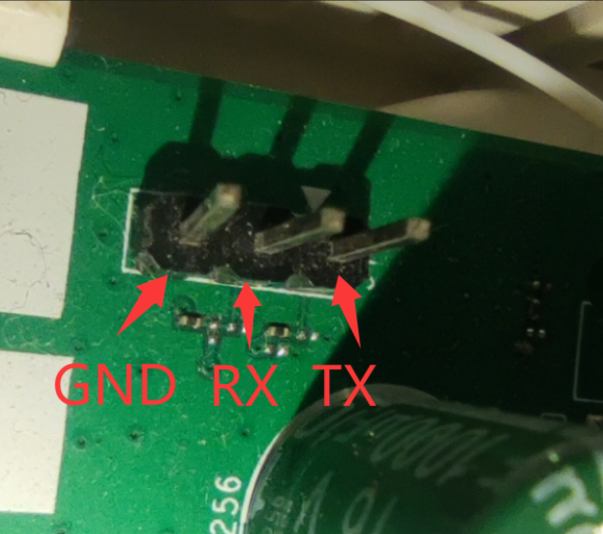

# XG-040G-MD 免拆刷机教程

> ⚠⚠⚠ 刷机有风险，因刷机造成的任何损失，由刷机人自行承担。

## 准备工作

为了避免后期的各种奇怪问题，把电脑的无线网卡关了，然后为电脑设置网卡多网段 IP。

把需要用到的网段都填进去，譬如：

- `192.168.0.16`
- `192.168.1.16`
- `192.168.1.254`

完了测试多 IP 是否通了，通了往下走。

---

## 一、准备 FTP 软件

把免拆包 `an758x-stock2ubi` 放到 ftp 目录下。

- 免拆包开源地址：<https://github.com/pbs05/an758x-stock2ubi>
- ftp 服务器地址设置为 `192.168.1.254`（这地址根据自己的需求修改，如果 ftp 地址修改，下面的一键 ftp 备份的 `192.168.1.254` 也要做相应修改）

> 注意：确保网线是插在路由器的千兆网口。

---

## 二、登陆路由器

登录 Web 超管页面地址：<http://192.168.1.1/>

- 账号：`CMCCAdmin`
- 密码：`aDm8H%MdA`

telnet 账号：`user`（或 `useradmin`），密码：光猫背后贴纸上的"默认终端配置密码"（每台不同）

确认能登录。

登录不进去，就在开机的状态下长按光猫 reset 键约 12 秒恢复出厂再试。重新登陆。

---

## 三、获取 telnet 超级密码

### 1. 开启 telnet 服务

登录 Web 超管页面成功后，在浏览器地址栏打开：

<http://192.168.1.1/system.cgi?telnet>

在打开的页面中，点击"打开"按钮以开启 telnet 服务。

```
telnet status: 开启
```

### 2. 获取 SU 和 telnet 超级密码

浏览器打开 <http://192.168.1.1/upgrade.cgi> ，下载日志文件。

解压并打开日志中的 `/tmp/tar/logs/` 文件夹，找到 `messages.0.tgz`，解压出 `messages.0` 文件夹。

在 `messages.0\logs` 下打开 `messages` 文件。

如果没有 `messages.0.tgz`，就直接打开 `/tmp/tar/logs/messages`。

用记事本打开解压后的 `messages`，用搜索 `SuPassword` 或者 `supass` 找 root 密码。

譬如：

```
COM_ServiceManage.SuPassword, val=hu9udPGkZm5v
```

（每个路由的超密不同，记下自己的）

---

## 四、备份系统

Cmd 下登录光猫：

```bash
telnet 192.168.1.1
```

- 输入用户名 `user`（`user` 印刷在光猫背后，有些是 `useradmin`，根据实际输入）
- 密码在光猫背后的"默认终端配置密码" `k8@ba583`（每个猫的密码都不同，查找自己的）
- 再输入 `su`，输入超级密码（刚才日志找出来的那个）

示例：

```
Login: user
Password:
$ su
Password:
#
```

### ftp 一键备份系统（分两次备份）

**第一次备份**（mtd0 ~ mtd13）：

```bash
dd if=/dev/mtd0  | tftp -p -l - -r mtd0-bootloader.bin     192.168.1.254 && \
dd if=/dev/mtd1  | tftp -p -l - -r mtd1-romfile.bin       192.168.1.254 && \
dd if=/dev/mtd2  | tftp -p -l - -r mtd2-kernel.bin        192.168.1.254 && \
dd if=/dev/mtd3  | tftp -p -l - -r mtd3-rootfs.bin        192.168.1.254 && \
dd if=/dev/mtd4  | tftp -p -l - -r mtd4-kernel_slave.bin  192.168.1.254 && \
dd if=/dev/mtd5  | tftp -p -l - -r mtd5-rootfs_slave.bin  192.168.1.254 && \
dd if=/dev/mtd6  | tftp -p -l - -r mtd6-bosa.bin          192.168.1.254 && \
dd if=/dev/mtd7  | tftp -p -l - -r mtd7-ri.bin            192.168.1.254 && \
dd if=/dev/mtd8  | tftp -p -l - -r mtd8-flag.bin          192.168.1.254 && \
dd if=/dev/mtd9  | tftp -p -l - -r mtd9-flagback.bin      192.168.1.254 && \
dd if=/dev/mtd10 | tftp -p -l - -r mtd10-config.bin       192.168.1.254 && \
dd if=/dev/mtd11 | tftp -p -l - -r mtd11-data.bin         192.168.1.254 && \
dd if=/dev/mtd12 | tftp -p -l - -r mtd12-oopsfs.bin       192.168.1.254 && \
dd if=/dev/mtd13 | tftp -p -l - -r mtd13-log.bin          192.168.1.254
```

回车，开始备份，出现 `#` 继续下一键。

**第二次备份**（mtd14 ~ mtd16）：

```bash
dd if=/dev/mtd14 | tftp -p -l - -r mtd14-nsb_master.bin   192.168.1.254 && \
dd if=/dev/mtd15 | tftp -p -l - -r mtd15-nsb_slave.bin    192.168.1.254 && \
dd if=/dev/mtd16 | tftp -p -l - -r mtd16-all_flash.bin    192.168.1.254
```

回车，开始备份，出现 `#` 就是备份完成。

备份完的文件在 ftp 目录下，存好备用。其中，`mtd6-bosa.bin` 是校准文件，一会需要用到。

---

## 五、刷机

确保 `an758x-stock2ubi`（免拆包开源地址：<https://github.com/pbs05/an758x-stock2ubi>）已经放到 ftp 目录下。

```bash
telnet 192.168.1.1
# 账号、密码、su

cd /tmp
tftp -gr an758x-stock2ubi 192.168.1.254
chmod +x /tmp/an758x-stock2ubi
/tmp/an758x-stock2ubi
```

输出如下：

```
# cd /tmp
# tftp -gr an758x-stock2ubi 192.168.1.254
# chmod +x /tmp/an758x-stock2ubi
# /tmp/an758x-stock2ubi
MTD write protection cleared
AN758x Stock2UBI listening on http://0.0.0.0:3333
```

> 在此界面下，千万别在 cmd 框下进行任何操作。

显示如下信息就代表成功：

```
MTD write protection cleared
AN758x Stock2UBI listening on http://0.0.0.0:3333
```

浏览器**无痕模式**打开：<http://192.168.1.1:3333>

- 备份
- 如已备份，按继续跳过

> 重要 重要 重要
>
> 重启后访问 `192.168.0.1` ，继续在 U-Boot 恢复页面安装。首次启动时，页面可能需要约 1 分钟才会出现。

如不成功，那就请拆机，用 ttl 模式刷。

### 进入刷机台后

按顺序执行：

1. 首先一定要先刷一个 `preloader.bin`
2. 重构 ubi
3. 刷 bl3
4. 刷 `ponwrt-airoha-an7581-fiberhome_hg5585f-ct-squashfs-sysupgrade.itb`
   - 固件代码开源地址：<https://github.com/pbs05/ponwrt>
5. 板级数据 `factory · UBI · 1.0 MiB`
6. 启动成功

如不成功，那就请拆机，用 ttl 模式刷。



---

**完**
