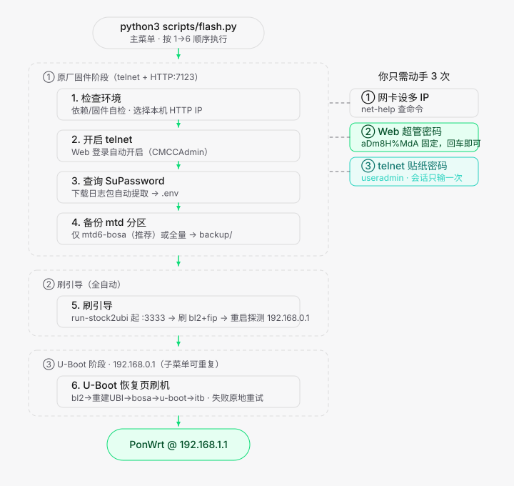

# XG-040G-MD 免拆刷机流程图



## 只需手动 3 次，其余在菜单里完成

| # | 操作 | 说明 |
|---|---|---|
| ① | 网卡设多 IP | `python3 scripts/flash.py net-help` 查命令 |
| ② | 超管密码 | `aDm8H%MdA`（固定，回车即可） |
| ③ | useradmin 密码 | 光猫背后贴纸，每台不同 |

## 一个入口，菜单 1→6

```bash
python3 scripts/flash.py
```

启动后进入主菜单，新手按 1→6 顺序选即可，每步可重复执行：

| 菜单 | 步骤 | 内部自动完成的事 |
|---|---|---|
| 1 | 检查环境 | 依赖、目录、固件文件、连通性自检，并**列出本机已绑定 IP 供选择**（光猫访问电脑的地址，自动标注同网段） |
| 2 | 开启 telnet | Web 登录 → `telnet off/on` 清残留 → 验证登录提示 |
| 3 | 查询 SuPassword | Web 下载日志包，grep 提取超密写入 `.env` |
| 4 | 执行备份 | 二选一：**①仅 mtd6-bosa**（校准，256KB，推荐）/ **②全量 mtd0~16**；自动内联启动 HTTP，telnet dd\|curl 到 backup/ |
| 5 | 刷引导 | **自动先 run-stock2ubi**（curl 下载+chmod 校验+起 :3333，首启最长等 90s；已在跑自动跳过）→ web-flash 刷 bl2+fip → 设备重启后**自动探测 192.168.0.1 恢复页（超时 20s）** |
| 6 | U-Boot 刷机 | 进入 192.168.0.1 恢复页的 1-5 步子菜单，完成后选 r 重启 |

> 第 1 步会列出本机所有已绑定 IP 让你选择光猫访问电脑的地址（标注哪个与光猫同网段），选择记入 `scripts/.env` 的 `HTTP_IP`；**若没执行检查环境，则用默认 `192.168.1.254`**。也可用 `--http-ip` 强制指定。
> 第 4/5 步的 HTTP 文件服务在脚本后台线程内联运行，**无需再另开终端**；默认端口 `7123`（可用 `--http-port` 改），脚本退出时会自动发请求关闭该服务，不留残留进程。
> 子命令（check / backup / web-flash 等）仍可单独调用，供脚本化与排障。

## 凭据说明

| 凭据 | 来源 | 写入位置 |
|---|---|---|
| Web 账号（MD：`CMCCAdmin`；TF：`telecomadmin`） | 各机型出厂超管账号 | `.env` 的 `MD_WEB_USER` / `TF_WEB_USER` |
| Web 密码（MD：`aDm8H%MdA`；TF：`nE7jA%5m`） | 各机型出厂默认 | `.env` 的 `MD_WEB_PASS` / `TF_WEB_PASS` |
| 当前机型 | `DEVICE_MODEL`（默认 `MD`，可 `TF`） | `.env` 的 `DEVICE_MODEL` |
| telnet 用户名（MD：user/useradmin；TF：固定 root） | MD 光猫背后贴纸；TF 无需 | 仅当前会话内存，**只问一次**，不写 `.env` |
| telnet 密码（MD：贴纸；TF：SU 超密） | 每台不同 | 仅当前会话内存，**只问一次**，不写 `.env` |
| SuPassword（超密） | MD 从日志明文提取；TF 从 dumpdatamodel.cgi 抓密文 AES 解密 | `.env` 的 `SU_PASS` |

> **机型支持**：
> - **MD（诺基亚 XG-040G-MD，移动）**：固件放 `uboot-md/`，开机长按 reset 12 秒恢复出厂，
>   开 telnet 走 `/system.cgi?telnet+off/on`（80），telnet 以 `user/useradmin` + `su` 登录。
> - **TF（诺基亚 XG-040G-TF，电信）**：固件放 `uboot-tf/`（**`sysupgrade.itb` 需自行放入**），
>   被运维改过超密时需**拔光纤 + 长按 reset 到指示灯闪烁**恢复出厂，开 telnet 走
>   `:8080/system.cgi?telnet`，SuPassword 从 `:8080/dumpdatamodel.cgi` 抓密文用 AES 解密，
>   telnet 以 `root` + 超密直登（提示符 `$`）。
>
> 固件文件名含 preloader / fip / `.itb` 关键字即被自动识别。
> 机型差异集中在 `lib/models.py`（端口 / 开 telnet 方式 / 取密方式 / 登录方式），
> 命令层按 profile 字段 dispatch，新增机型只需追加一个 profile 条目。
>
> Web 账号/密码不写死在代码：统一从 `.env` 的 `{机型}_WEB_USER` / `{机型}_WEB_PASS` 读取，
> 首次交互输入后自动写入。
>
> Web 凭据和 SuPassword 首次输入后写入 `scripts/.env`，后续命令自动复用。
> telnet 用户名和密码**不写入 `.env`**，但在同一次主菜单运行内（如第 4 步备份、第 5 步刷引导）只需输入一次；
> 重启脚本后会重新询问。

## 两种使用场景

### 全新原厂机（全流程）

按上面 1~6 依次执行。

### 已刷 PonWrt 重刷/换固件（只需 1 步）

重启时按住 reset 进 U-Boot 恢复模式（192.168.0.1），然后：

```bash
python3 scripts/flash.py uboot-flash        # 进菜单，a 全刷或逐步骤执行
python3 scripts/flash.py uboot-flash --step 5   # 非交互，只换系统固件
```

菜单说明：

| 选项 | 作用 |
|---|---|
| 1~5 | 单独执行该步骤，可重复 |
| a | 1→5 顺序全刷（中途失败即中止，可用 `--skip-*` 跳过） |
| r | 5 步完成后重启设备，并等待新系统上线 |
| 0 | 退出（不重启） |
